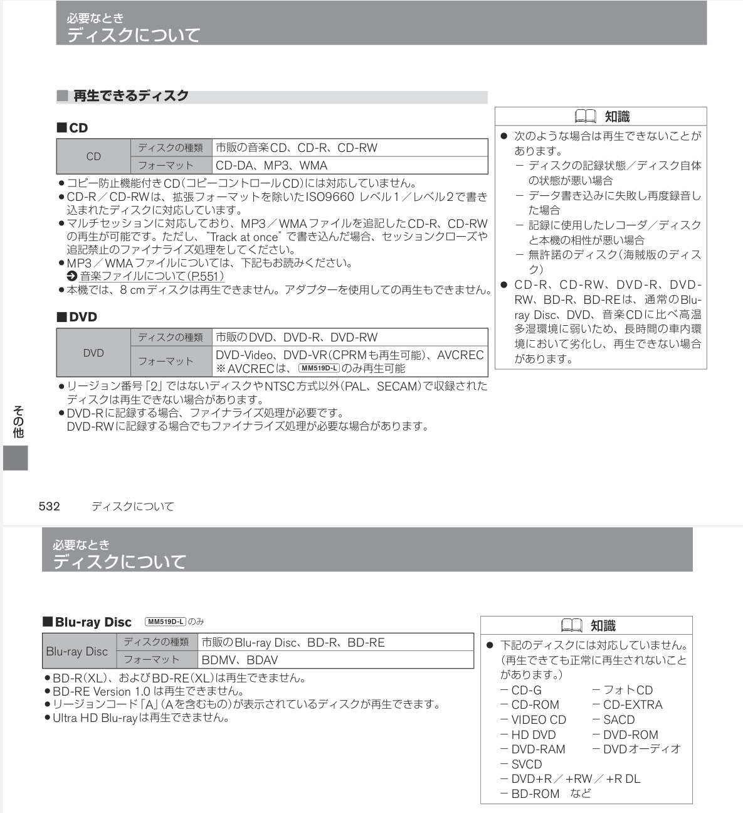
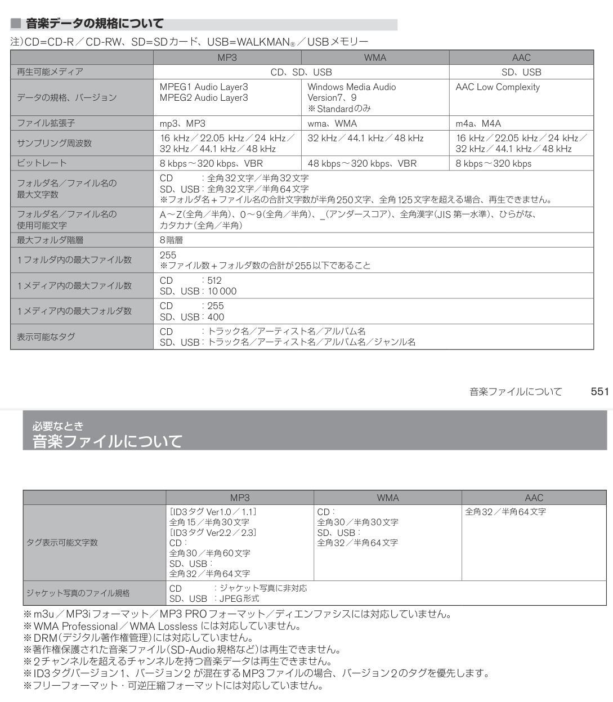
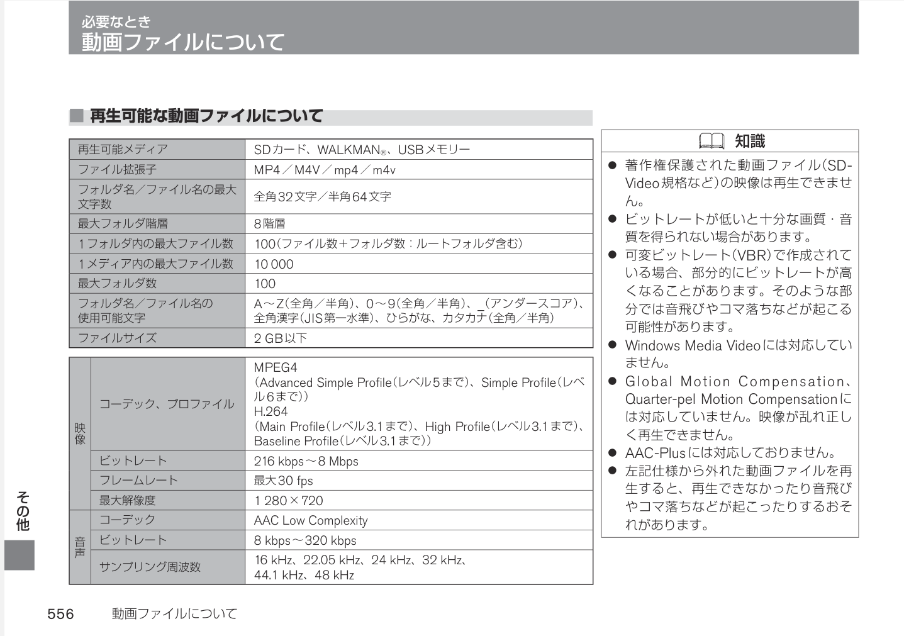

# MM319D-W - Магнитола в Nissan Note E12

Заметка для тех, кто все таки захотел разобраться, что к чему.

## Disc

DVD+R не читаются - имейте это ввиду.

Что реально поддерживается:

CD (CD-R/CD-RW):

Форматы: CD-DA, MP3, WMA — то есть музыкальные файлы только тут.

DVD (DVD-R/DVD-RW):

Только видеоформаты: DVD-Video, DVD-VR (в т.ч. CPRM), AVCREC (AVCREC — только на MM519D-L)
Регион 2, только NTSC (PAL/SECAM — нет). DVD-R нужно финализировать.

## Audio

На CD магнитола вообще не играет AAC/M4A (только MP3, WMA)
 

По таблице строка «再生可能メディア» (носитель):

MP3 → CD, SD, USB
WMA → CD, SD, USB
AAC (.m4a) → только SD, USB (CD нет)
То есть записанный аудио-CD/диск с .m4a она не увидит в принципе. Это я проверил на себе, поэтому AAC (.m4a) кидайте только на SD карту.

На DVD нет смысла записывать музыкальные файлы, плюс ещё и диск должен быть DVD-R (DVD+R не читаются).
В спецификации нет чтения MP3/AAC с DVD как с данных: DVD-слот ждёт DVD-Video/VR/AVCREC, а не папку с mp3.

## Video

Про воспроизводимые видеофайлы. Формат:

Видеофайлы MP4 / M4V (расширения .mp4 / .m4v)

Носители: SD-карта, USB-флешка, WALKMAN. Ключевой момент - DVD/CD идут нафиг с файлами, оно понимает только VCD/DVD Video.

Кодеки: MPEG4 (Advanced Simple Profile до ур. 5, Simple Profile до ур. 6) и H.264 (Main Profile до ур. 3.1, High Profile до ур. 3.1)
Макс. разрешение: 1280×720
Кадров/с: до 30 fps
Битрейт: 216 kbps – 8 Mbps
Аудио: AAC-LC (Low Complexity), 8–320 kbps, 16 / 22.05 / 24 / 32 / 44.1 / 48 kHz

Ограничения на файлы

Размер файла: до 2 ГБ
До 10 000 файлов на носителе, до 100 в папке, до 8 уровней вложенности папок
Имя файла: до 32 полноширинных / 64 полуширинных символов; допустимы A–Z, 0–9, _, катакана

Не поддерживается: Windows Media Video (WMV), AAC-Plus, Global/Quarter-pel Motion Compensation, файлы с защитой авторских прав (напр. стандарт SD-Video). 
Файлы вне этих спецификаций могут не проигрываться либо давать пропуски звука/кадров.